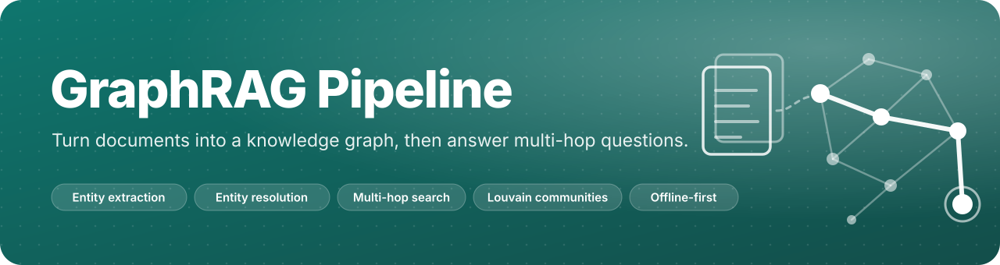
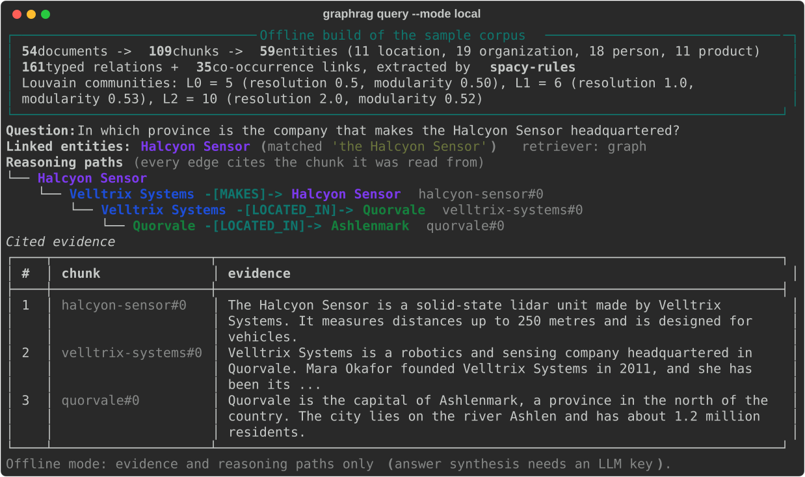
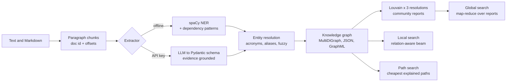
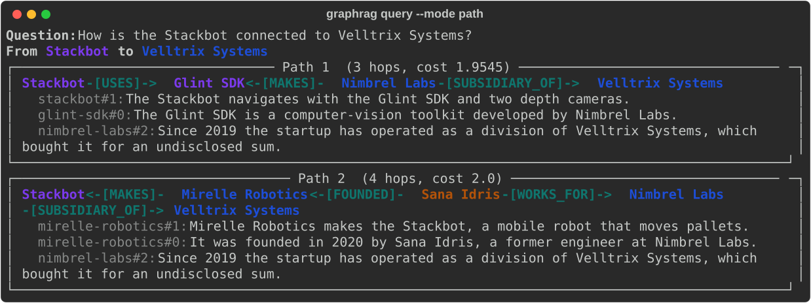
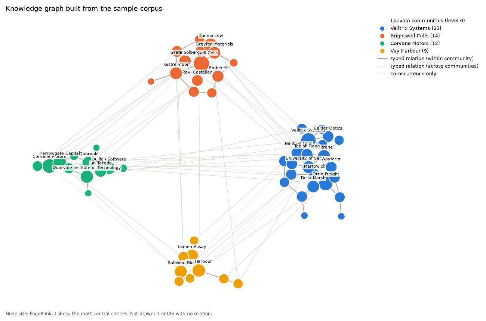
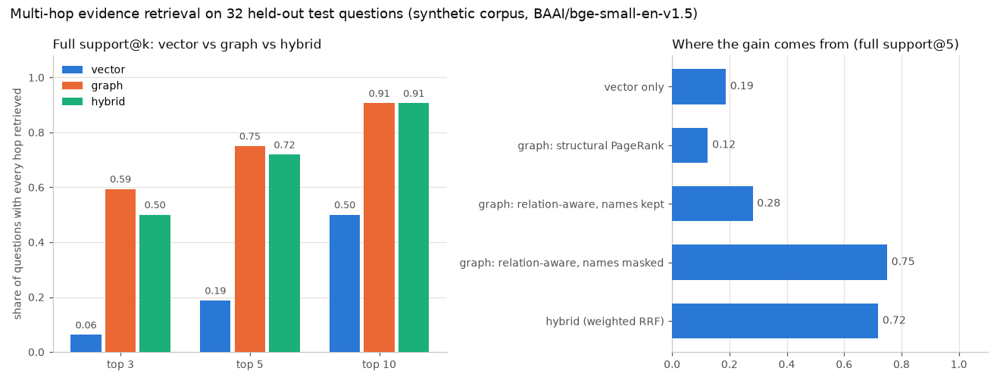

<p align="center">
  
</p>

<p align="center">
  <a href="https://github.com/iamsammy-ak/graphrag-knowledge-pipeline/actions/workflows/ci.yml"></a>
  
  
  
  
  <a href="LICENSE"></a>
</p>

**GraphRAG Knowledge Pipeline** turns unstructured text into a knowledge graph (entities, typed relations,
communities) and answers questions that need several connected facts, citing the sentence behind every step. It
runs fully offline with classical NLP, and switches to an LLM for extraction, reports and answers when an
OpenRouter key is present.

On a bundled 54-document corpus with 32 held-out multi-hop questions, graph search retrieves all the evidence a
question needs within the top 5 chunks for **75%** of questions, against **19%** for vector search alone.



## Why this exists

Vector search finds passages that *look like* the question. Multi-hop questions break that: in "In which province
is the company that makes the Halcyon Sensor headquartered?" the sentence with the answer ("Quorvale is the capital
of Ashlenmark") never mentions the sensor or its maker. You have to read one fact, follow it to the next entity and
read again. A knowledge graph makes those links explicit, so retrieval can walk from the question's entity to the
evidence, and show its working.

This project builds that graph from plain text and measures, on a controlled benchmark, when walking it beats
plain vector search and why.

## Features

| | |
|---|---|
| 📄 **Ingestion with provenance** | Text and Markdown split into paragraph chunks; every chunk, mention and relation keeps its document id and character offsets |
| 🧩 **Two extractors, one interface** | Offline: spaCy NER plus dependency patterns (subject-verb-object, passives, appositions, copulas, prepositions) and low-weight co-occurrence edges. With a key: an LLM fills a Pydantic schema and every relation must quote evidence found in the chunk |
| 🔗 **Entity resolution** | Normalisation, acronyms ("QIT"), short forms ("Velltrix"), surnames ("Okafor"), near-duplicates ("Halcyon Sensors"), with types voted from NER, descriptions and relation roles |
| 🕸️ **Graph with provenance** | `networkx.MultiDiGraph`: one edge per piece of evidence; saves to JSON (reloadable) and GraphML (Gephi, yEd, Neo4j) |
| 🧭 **Local search** | Relation-aware beam search from the question's entities, plus personalised PageRank and k-hop expansion as structural baselines |
| 🛤️ **Path search** | Explains how entity A connects to B, hop by hop, with the evidence sentence for each relation |
| 🏘️ **Communities and global search** | Louvain at three resolutions, extractive (or LLM) community reports, map-reduce answers over reports |
| 📏 **Benchmark** | 42 hand-written 2-3 hop questions with gold supporting chunks, two extraction gold sets, dev/test split |
| ⌨️ **CLI and API** | `graphrag build / query / communities / bench / demo / serve` (FastAPI on port 8703) |

## How it works



1. **Ingest.** Each paragraph becomes a chunk (headings attach to the next paragraph, long paragraphs split at
   sentence ends), and `document.text[chunk.start:chunk.end] == chunk.text` always holds.
2. **Extract.** Offline, spaCy finds names; a corpus-wide gazetteer then recognises a name everywhere it was seen
   once (including "Corvane" for "Corvane Motors"), a small salience model resolves "she", "its" and "the company",
   and dependency patterns turn sentences into typed relations from a fixed vocabulary (FOUNDED, LEADS, LOCATED_IN,
   MAKES, USES, SUPPLIES ...). Entity pairs that share a sentence but match no pattern get a `RELATED_TO` edge at
   a fifth of the weight.
3. **Resolve.** Mentions merge into canonical entities with stable ids only when exactly one compatible long form
   exists, and a place never merges into an organisation ("Quorvale" stays apart from "Quorvale Institute of
   Technology").
4. **Build the graph** and detect communities with Louvain at resolutions 0.5, 1.0 and 2.0 (5, 6 and 10
   communities on the sample corpus, modularity 0.50-0.53). Each community gets a report: its most central
   entities by PageRank, key relations and sentences quoted from the corpus with their chunk ids.
5. **Search.**
   * *Local*: link the question's entities, then run a beam search over relation paths. Each edge is scored by how
     well its evidence sentence matches the question **with entity names masked in both** ("X is a robotics
     company headquartered in X"), so the walk follows relation wording ("makes", then "headquartered") instead of
     shared names. Each chunk is credited with the best path through its evidence.
   * *Path*: Yen's k-shortest loop-free paths, where an edge costs 1 / weight: 1 for a typed relation stated
     once (less when several sentences state it) and 5 for a co-occurrence link.
   * *Global*: rank community reports by similarity to the question, then extract (offline) or map-reduce (LLM)
     the key points.





## Benchmarks

Evidence retrieval on the **32 test questions** (synthetic corpus, embeddings `BAAI/bge-small-en-v1.5`). A
question has *full support* when every hop's supporting chunk is in the top k; *recall* is the share of hops
covered.

| method | recall@3 | recall@5 | recall@10 | full support@3 | full support@5 | full support@10 |
|---|---:|---:|---:|---:|---:|---:|
| vector only | 0.47 | 0.55 | 0.76 | 0.06 | 0.19 | 0.50 |
| graph: structural PageRank (ablation) | 0.38 | 0.52 | 0.77 | 0.00 | 0.12 | 0.53 |
| graph: relation-aware, names kept (ablation) | 0.45 | 0.61 | 0.86 | 0.06 | 0.28 | 0.66 |
| **graph local search** (relation-aware, names masked) | **0.77** | **0.87** | 0.95 | **0.59** | **0.75** | **0.91** |
| hybrid (weighted RRF, graph 3 : vector 1) | 0.73 | 0.86 | **0.96** | 0.50 | 0.72 | **0.91** |



What the numbers say:

* **Structure alone is not enough.** PageRank from the question's entity finds the bridge entity but cannot tell
  which of its ten chunks answers *this* question; it does no better than vector search.
* **Relation-aware traversal is where the gain comes from**, and masking entity names is what makes it work
  (full support@5 0.28 without masking, 0.75 with it).
* **Hybrid did not beat graph alone** here: at small k, fusing in a weaker retriever costs slots. It helps only
  marginally at k = 10.
* **Three hops are harder**: on the 12 three-hop questions (dev and test), graph search reaches full support@10
  for 0.75 of them, vector search for 0.25.
* With the dependency-free hashing embedder used in CI, graph search still reaches full support@5 of 0.59 against
  0.06 for vector search ([results](benchmarks/results/benchmark-hashing-512.md)).

Extraction quality of the offline extractor:

| gold set | entities found (P / R) | relations, typed and directed (P / R / F1) | any relation between the right pair (F1) |
|---|---:|---:|---:|
| development: 14 documents of the corpus (optimistic) | 1.00 / 1.00 | 0.96 / 0.84 / 0.90 | 0.95 |
| **held-out: 8 new documents** | **0.81 / 1.00** | **0.67 / 0.52 / 0.58** | **0.65** |

The rules were written while reading the corpus, so the development score is optimistic. The held-out documents
were written in a different style and labelled after the rules were frozen: that is the honest number. Only 10-17%
of co-occurrence edges link pairs the gold set calls related, which is why they carry a fifth of the weight.

Reproduce (results land in [`benchmarks/results/`](benchmarks/results/benchmark-bge-small-en-v1.5.md) as JSON
with per-question rankings and as Markdown):

```bash
graphrag bench --embedder bge --chart assets/benchmark.png   # downloads bge-small (about 65 MB) once
graphrag bench --embedder hashing                            # no download
```

**Data and assumptions.** The corpus, questions and gold labels are synthetic and fictional, written for this
project: 54 short documents about invented companies, people, products and places (any resemblance to real ones
is coincidental). Retrieval settings were chosen on 10 `dev` questions and the 32 `test` questions were not used
for tuning; the full 42-question tables are in the results file. The graph is built by the offline extractor; no
LLM was used for any number above.

## Quick start

```bash
git clone https://github.com/iamsammy-ak/graphrag-knowledge-pipeline.git
cd graphrag-knowledge-pipeline
python -m venv .venv
source .venv/bin/activate          # Windows: .venv\Scripts\activate
pip install -e ".[dev,models]"
python -m spacy download en_core_web_sm
graphrag demo                      # builds the sample corpus offline, runs local, path and global search
```

Your own documents:

```bash
graphrag build path/to/folder --out .graphrag
graphrag query "Who founded the company that makes X?" --mode local --retriever graph
graphrag query "How is A connected to B?" --mode path
graphrag query "What are the main themes?" --mode global
graphrag communities --level 1 --png graph.png
graphrag serve                     # FastAPI on http://127.0.0.1:8703 (pip install -e ".[api]")
```

Everything works without a key. For LLM extraction, community reports and cited answers, get a free key at
[openrouter.ai/keys](https://openrouter.ai/keys) and copy `.env.example` to `.env`:

| Variable | Purpose |
|---|---|
| `OPENROUTER_API_KEY` | Enables the LLM extractor, LLM community reports and answer synthesis |
| `OPENROUTER_MODELS` | Optional comma-separated model list, tried in order on rate limits and errors |

`--offline` forces the offline path even when a key is set.

## Use it as a library

```python
from graphrag_pipeline import BuildConfig, LocalSearcher, build_index, corpus_dir, path_search

index = build_index(corpus_dir(), BuildConfig(extractor="spacy"))

searcher = LocalSearcher(index.kg)  # pass get_embedder("bge") for embedding-based relevance and hybrid search
result = searcher.search("Who founded the manufacturer of the Wayfarer truck?", k=3, retriever="graph")
for edge in result.traversal:
    left, right = (edge.source_name, edge.target_name) if edge.forward else (edge.target_name, edge.source_name)
    print(f"{'  ' * edge.depth}{left} -[{edge.relation}]-> {right}   ({edge.chunk_id})")

paths = path_search(index.kg, "How is the Stackbot connected to Velltrix Systems?").paths
print(" -> ".join([paths[0].hops[0].source_name, *(h.target_name for h in paths[0].hops)]))
```

Output (the full script is [`examples/quickstart.py`](examples/quickstart.py)):

```
  Wayfarer -[USES]-> Ember-9   (wayfarer#1)
  Corvane Motors -[MAKES]-> Wayfarer   (wayfarer#0)
    Corvane Motors -[LOCATED_IN]-> Dunmarrow   (corvane-motors#0)
  Wayfarer -[USES]-> Halcyon Sensor   (wayfarer#1)
    Ilse Varga -[FOUNDED]-> Corvane Motors   (corvane-motors#0)
Stackbot -> Glint SDK -> Nimbrel Labs -> Velltrix Systems
```

## Design decisions

* **Score edges by relation wording, not by names.** The first graph retriever (personalised PageRank) found the
  right entities but could not choose among their chunks. Scoring each edge's evidence sentence against the
  question, with entity names masked on both sides, lets the walk follow "makes" and then "headquartered". The
  alternative, an LLM choosing the next hop at every step, is what larger GraphRAG systems do; this keeps the
  same idea offline and measurable, and the ablation shows each part's contribution.
* **Classical extractor first, LLM optional.** A rule-based extractor is deterministic, free, runs in CI and makes
  every benchmark number reproducible. It is also brittle on unseen phrasing (held-out relation F1 0.58), so the
  LLM extractor sits behind the same interface, and its relations are only kept when the quoted evidence is
  found in the chunk.
* **Conservative entity resolution.** A wrong merge creates a false bridge that multi-hop search will happily
  walk, while a missed merge only loses a link. Short forms merge only into a unique compatible long form, places
  never merge into organisations, and fuzzy matching needs a 0.92 string ratio within one type.
* **One edge per piece of evidence.** A `MultiDiGraph` keeps every sentence that states a fact as its own edge with
  chunk id and offsets, so every answer can be traced back to text; weights add up only in the undirected
  projection used for ranking and communities.
* **Rank fusion instead of score mixing.** PageRank mass and cosine similarity live on unrelated scales, so the
  hybrid uses weighted reciprocal rank fusion. It is reported even though it did not beat graph search alone.
* **A benchmark that guards against fooling myself.** A dev/test split for retrieval settings and a held-out,
  differently written gold set for extraction, because the same person wrote the corpus and the rules.

## Project structure

```
graphrag-knowledge-pipeline/
├── src/graphrag_pipeline/
│   ├── ingest.py              loading, offset-preserving Markdown masking, sentences, paragraph chunks
│   ├── extraction/            spaCy rules (spacy_extractor.py), LLM extractor, relation vocabulary
│   ├── resolution.py          normalisation, acronyms, short forms, fuzzy merges, type voting
│   ├── graph.py               KnowledgeGraph: MultiDiGraph + chunks + indices, JSON and GraphML
│   ├── communities.py         Louvain at several resolutions, parent links, modularity
│   ├── reports.py             extractive and LLM community reports
│   ├── search/                linking, local (beam / PPR / k-hop), vector, hybrid RRF, paths, global
│   ├── evaluation/            retrieval and extraction metrics, benchmark runner
│   ├── pipeline.py            build_index and the on-disk index
│   ├── llm.py · config.py     OpenRouter client: model fallback, disk cache, JSON repair
│   ├── embeddings.py          bge-small via fastembed, hashing stand-in
│   ├── cli.py · api.py        Typer CLI and FastAPI service
│   ├── render.py · viz.py     Rich output, matplotlib figures
│   └── data/                  corpus/ (54 docs), heldout/ (8 docs), questions and gold labels
├── benchmarks/                make_assets.py and results/ (JSON + Markdown)
├── examples/quickstart.py
├── assets/                    banner, terminal SVGs, graph and benchmark images
└── tests/                     77 tests (unit, property-based, CLI, API)
```

## Testing

```bash
ruff check . && mypy && pytest -q
```

77 tests cover offset invariants of chunking and Markdown masking (property-based), each dependency pattern,
pronoun resolution, entity merging rules, JSON and GraphML round trips, community partitions, the beam search on a
3-hop chain, rank fusion properties, path and global search, the LLM client's model fallback and cache, evidence
grounding of LLM relations (with scripted fake models), benchmark metrics, the CLI and every API endpoint. Tests
force offline mode even when a key is set. CI runs on Python 3.10 and 3.12.

## Limitations

* **The corpus is small, synthetic and clean**, and written by the author of the rules. Real text has more
  pronouns, lists, tables and nested clauses; expect the held-out extraction numbers, not the development ones.
* **The offline extractor misses what needs world knowledge** and fixed vocabulary hides some relations ("the mayor
  of Brask" is not mapped to LEADS). NER also mistypes invented company names as people, which can create bogus
  aliases (seen on the held-out set: "Aero" for "Kelvane Aero").
* **Local search needs a named entity in the question.** Without one, graph search returns nothing and only the
  vector side of the hybrid works.
* **No answer is generated offline**: the offline output is the cited evidence and the reasoning paths.
* **The LLM paths are tested with scripted fake models only**; they have not been benchmarked against a live model.
* **Scale**: exact vector search and a Python beam search are fine for thousands of chunks, not millions.
* Louvain partitions at different resolutions do not nest, so community parents are best-overlap matches.

## Roadmap

- [ ] Benchmark the LLM extractor on the held-out set and compare it with the spaCy rules
- [ ] Evaluate on a public multi-hop dataset (a MuSiQue or 2WikiMultiHopQA subset)
- [ ] Hierarchical Leiden communities with strict nesting
- [ ] Store chunk and evidence embeddings in the index instead of recomputing them at load time

## License

[MIT](LICENSE) © 2026 Abhishek Kumar
